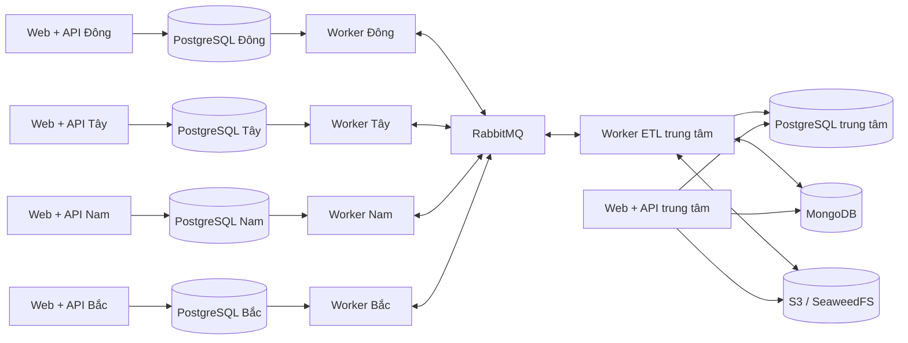

# Kiến trúc và hợp nhất dữ liệu

## Topology

Mỗi nút phục vụ giao diện riêng từ cùng image. Khi trung tâm hoặc broker gián đoạn, chi nhánh tiếp tục đăng nhập và ghi giao dịch vào PostgreSQL của chính nó. Outbox giữ sự kiện chờ gửi. Kho tài liệu trung tâm không có chế độ offline tại chi nhánh.

Phân tán được thực hiện ở tầng ứng dụng bằng phân mảnh dữ liệu theo chi nhánh. Không sử dụng logical replication đa master, MongoDB sharding, giao dịch XA hoặc tuyên bố một transaction ACID phủ tất cả dịch vụ. Docker trên một máy mô phỏng lỗi dịch vụ/kết nối; chưa cung cấp khả năng chịu lỗi máy vật lý.

## Nguồn chuẩn và quyền sở hữu

| Dữ liệu | Nguồn chuẩn | Bản sao / cách hợp nhất |
| --- | --- | --- |
| Danh mục sản phẩm, giá | PostgreSQL trung tâm | Sự kiện có version xuống chi nhánh; bỏ qua version cũ |
| Tài khoản mới, phân quyền | PostgreSQL trung tâm | Đồng bộ tài khoản tới chi nhánh liên quan; admin tới cả bốn |
| Đơn bán, nhập, trả, điều chỉnh, tồn kho | PostgreSQL chi nhánh | Sự kiện bất biến tạo mô hình đọc tại trung tâm |
| Liên hệ khách hàng/NCC | Chi nhánh tạo liên hệ | Đồng bộ bản ghi lên trung tâm; chưa hợp nhất danh tính khách hàng liên chi nhánh |
| Điều chuyển | Nguồn ghi xuất, đích ghi nhận | Trung tâm chuyển tiếp trạng thái, hợp nhất hai đầu |
| Văn bản tài liệu, trạng thái xử lý, phản hồi | MongoDB trung tâm | API ghép với PostgreSQL bằng product_id, branch_id và order_id |
| Tệp ảnh/PDF/TXT gốc | S3 trung tâm | MongoDB giữ object key, MIME, checksum SHA-256, dung lượng và liên kết |

Một bản ghi Product hiện đại diện một SKU. Thông tin dòng đơn lưu snapshot tên, SKU và đơn giá tại thời điểm giao dịch để thay đổi danh mục không sửa lịch sử. Tiền VND lưu số nguyên; timestamp lưu UTC, giao diện hiển thị Asia/Ho_Chi_Minh.

## ETL giao dịch

1. API xác thực tài khoản và chi nhánh, kiểm tra dữ liệu đầu vào. Khóa các dòng tồn kho theo thứ tự product_id để tránh bán quá lượng có sẵn và giảm nguy cơ deadlock.
2. Giao dịch nghiệp vụ, sổ biến động kho và outbox được ghi trong cùng transaction PostgreSQL. Mã `Idempotency-Key` cùng dấu vân tay payload ngăn yêu cầu lặp tạo đơn mới; cùng mã nhưng khác nội dung trả lỗi 409.
3. Worker phát thông điệp persistent vào exchange direct và hàng đợi durable của đích. Chỉ ghi `sent_at` khi nhận publisher confirmation. Sự cố giữa publish và ghi sent_at có thể phát trùng.
4. Worker đích kiểm tra version, loại, nguồn sự kiện; ghi inbox và tác động nghiệp vụ trong cùng transaction. Chỉ ACK sau commit. `event_id` và `movement.id` ngăn áp dụng hai lần.
5. Biến động tồn kho cập nhật bằng phép cộng delta; danh mục cập nhật theo version. Tránh dùng snapshot đến muộn để ghi đè tồn kho.
6. Lỗi dữ liệu không xử lý được được giữ ở `dead_letters` trước khi ACK, hiển thị cho quản lý và cho phép thử lại. Lỗi kết nối DB/broker được thử lại sau 3 giây; message chưa ACK được broker phát lại khi kết nối đóng.

Đây là vận chuyển **at least once** với xử lý idempotent. Không tuyên bố message chỉ được gửi đúng một lần. Sử dụng publisher confirms và consumer acknowledgements theo [tài liệu RabbitMQ](https://www.rabbitmq.com/docs/confirms).

## ETL tài liệu và tìm kiếm

Tải tệp → kiểm tra loại/dung lượng → ghi S3 → ghi metadata MongoDB với trạng thái pending. Nếu ghi metadata thất bại, API cố gắng xóa object vừa ghi để tránh tệp không có liên kết. Nếu cả thao tác bù trừ cũng thất bại thì vẫn có thể tồn tại object mồ côi; xử lý dọn dẹp tự động chưa thuộc bản này.

Worker nhận tài liệu pending, ghi processing và thời gian thuê xử lý. PDF/TXT được trích xuất và chuẩn hóa thành văn bản tối đa 200.000 ký tự. PDF tối đa 100 trang; tệp mã hóa hoặc lỗi được ghi error. Worker chết giữa chừng thì tài liệu processing quá 10 phút được nhận lại. Ảnh/PDF không có text được ghi needs_ocr; không thực hiện OCR ở bản này.

Quản lý có thể kiểm tra/sửa text và xác nhận verified. Text xác nhận không tự ghi tồn kho hay doanh thu. Phản hồi khách hàng lưu dạng tài liệu MongoDB với product_id, branch_id, điểm đánh giá và nội dung.

`GET /api/search?q=...` tìm tên/SKU trong PostgreSQL và tên/nội dung tài liệu, phản hồi trong MongoDB, ghép product_id và trả giá, tồn kho theo chi nhánh, tài liệu liên quan. API lọc quyền trước khi trả dữ liệu; tải tệp gốc cũng phải qua kiểm tra quyền. Tìm kiếm hiện là chuỗi con, không phải semantic search; truy vấn MongoDB được escape regex.

S3 sử dụng SeaweedFS 4.52 với cấu hình `weed mini`, volume riêng và bucket được tạo sẵn; xem [hướng dẫn chính thức](https://github.com/seaweedfs/seaweedfs/wiki/Quick-Start-with-weed-mini).

## Điều chuyển và đối soát

Nguồn xuất hàng: trừ kho, tạo phiếu in_transit và phát sự kiện. Trung tâm ghi nhận và chuyển phiếu đến đích. Đích chỉ nhận phiếu đã biết, cộng kho một lần và ghi received; sự kiện trả về trung tâm rồi nguồn. Chưa nhận từng phần/hủy phiếu đang chuyển. Khi đối soát toàn chuỗi, hàng đang chuyển được xem riêng với hàng đang có tại cửa hàng.

Khoảng 60 giây/lượt, trung tâm lấy snapshot đã xác thực từ từng API chi nhánh, so số lượng từng SKU, số giao dịch và doanh thu thuần. Kết quả có thể là matched, pending, difference hoặc unreachable. So sánh trực tiếp trong lúc có giao dịch đang chạy không tạo snapshot nguyên tử toàn hệ thống; difference cần kiểm tra lại khi hàng đợi đã hết. Chức năng này báo chênh lệch, không tự sửa nguồn.

## Giới hạn triển khai đồ án

- Một broker, MongoDB và S3 trung tâm; chưa có HA/replica set, TLS ngoài máy cục bộ hay sao lưu tự động.
- Danh mục/tài khoản mới cần đồng bộ xuống chi nhánh. Bản này chưa có cập nhật/khóa tài khoản qua UI hoặc thu hồi tức thời quyền khi chi nhánh offline.
- UI danh sách giao dịch lấy tối đa 100 bản ghi gần nhất; API hỗ trợ offset/limit tới 500. Danh mục và liên hệ tối đa 500 bản ghi mỗi lần truy vấn.
- Báo cáo hiện là tổng cộng dồn và doanh thu thuần; chưa có lọc khoảng ngày, thuế, chiết khấu, công nợ hay định giá vốn tồn kho.
- Chưa có OCR, nhận hàng từng phần, hợp nhất khách hàng trùng danh tính hoặc tự động sửa đối soát.

Các giới hạn này không được trình bày như chức năng đã hoàn tất trong báo cáo bảo vệ.
